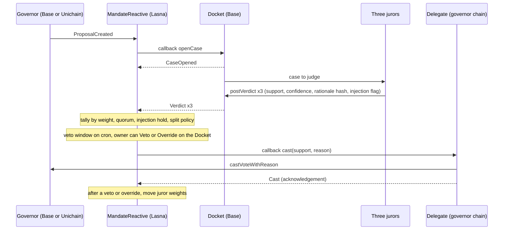

<!-- Generated by tools/judge/render.ts from evidence/summary.json (make docs). Do not edit by hand. -->

# Mandate

Mandate casts your DAO votes from a policy you write in plain language: three model jurors from three providers read each proposal against it, and a reactive contract on the Reactive Network tallies their verdicts, waits out your veto window and casts the vote on the governor's chain.

In the live run on Base Sepolia, Unichain Sepolia and Reactive Lasna, all 15 cases resolved with no stuck case and no failed callback: 7 votes cast, 2 vetoed by the owner, 3 held on an injection flag (2 planted attempts, 1 false positive), 2 held as splits (1 of them expired when its vote closed) and 1 given up because voting had closed before the veto window ended. 45 of 45 written opinions re-hash to the hash their verdict put on chain. The chain hops are quick (proposal to case open p50 1.4 s, n = 10); the free model tiers are the slow part (case open to third verdict p50 807.4 s, n = 15).

## Live site, video and addresses

- Live site: https://mandate-omni.vercel.app (no wallet needed: file a proposal on the demo DAO from the Propose page and follow its case on the Docket page)
- Video: coming
- Repository: https://github.com/Adwaitbytes/mandate

| Chain | Contract | Address | Sourcify |
|---|---|---|---|
| Reactive Lasna | MandateLogic | [`0x6fd18Ff568825BCC34095cCB195fcdD1ecC75dF2`](https://lasna.reactscan.net/address/0x6fd18Ff568825BCC34095cCB195fcdD1ecC75dF2) | [match](https://repo.sourcify.dev/5318007/0x6fd18Ff568825BCC34095cCB195fcdD1ecC75dF2) |
| Reactive Lasna | MandateReactive | [`0xd5897E56762eB47ac309610CDe8cbf03b5996560`](https://lasna.reactscan.net/address/0xd5897E56762eB47ac309610CDe8cbf03b5996560) | [match](https://repo.sourcify.dev/5318007/0xd5897E56762eB47ac309610CDe8cbf03b5996560) |
| Base Sepolia | Docket | [`0xE48a9dFdDBb8dD3bDE49a06d1113DaB58599F40c`](https://sepolia.basescan.org/address/0xE48a9dFdDBb8dD3bDE49a06d1113DaB58599F40c) | [match](https://repo.sourcify.dev/84532/0xE48a9dFdDBb8dD3bDE49a06d1113DaB58599F40c) |
| Base Sepolia | DemoVotesToken MDV | [`0x025E568DFc21874f2D690dA57E78fb43def2cC55`](https://sepolia.basescan.org/address/0x025E568DFc21874f2D690dA57E78fb43def2cC55) | [match](https://repo.sourcify.dev/84532/0x025E568DFc21874f2D690dA57E78fb43def2cC55) |
| Base Sepolia | DemoGovernor "Mandate Demo DAO" | [`0xD38490BCd74bAEBe081550C48E5cF5d90557266B`](https://sepolia.basescan.org/address/0xD38490BCd74bAEBe081550C48E5cF5d90557266B) | [match](https://repo.sourcify.dev/84532/0xD38490BCd74bAEBe081550C48E5cF5d90557266B) |
| Base Sepolia | DemoGovernor "slow start" | [`0x19E22b78ed01E5B7Bc6530fD3F86687d127bAd06`](https://sepolia.basescan.org/address/0x19E22b78ed01E5B7Bc6530fD3F86687d127bAd06) | [match](https://repo.sourcify.dev/84532/0x19E22b78ed01E5B7Bc6530fD3F86687d127bAd06) |
| Base Sepolia | DemoGovernor "brief vote" | [`0x2EB54888fA245F59970C90b3feea89c387c5906f`](https://sepolia.basescan.org/address/0x2EB54888fA245F59970C90b3feea89c387c5906f) | [match](https://repo.sourcify.dev/84532/0x2EB54888fA245F59970C90b3feea89c387c5906f) |
| Base Sepolia | DelegateFactory | [`0x0fAE8143f7D9C2cF18Ae68BEA374c2EF94F5E11d`](https://sepolia.basescan.org/address/0x0fAE8143f7D9C2cF18Ae68BEA374c2EF94F5E11d) | [match](https://repo.sourcify.dev/84532/0x0fAE8143f7D9C2cF18Ae68BEA374c2EF94F5E11d) |
| Base Sepolia | Delegate | [`0xDA5347702da783EDa85A1627896d944Ed8F2052C`](https://sepolia.basescan.org/address/0xDA5347702da783EDa85A1627896d944Ed8F2052C) | [match](https://repo.sourcify.dev/84532/0xDA5347702da783EDa85A1627896d944Ed8F2052C) |
| Unichain Sepolia | DemoVotesToken MDV | [`0xaBc9ECc0052C4fB0928dB1D1c2CDd397E1C840d1`](https://unichain-sepolia.blockscout.com/address/0xaBc9ECc0052C4fB0928dB1D1c2CDd397E1C840d1) | [match](https://repo.sourcify.dev/1301/0xaBc9ECc0052C4fB0928dB1D1c2CDd397E1C840d1) |
| Unichain Sepolia | DemoGovernor "Mandate Demo DAO" | [`0xFEacE2CD295E4Dea9839552ef1612bAF7f53cEB3`](https://unichain-sepolia.blockscout.com/address/0xFEacE2CD295E4Dea9839552ef1612bAF7f53cEB3) | [match](https://repo.sourcify.dev/1301/0xFEacE2CD295E4Dea9839552ef1612bAF7f53cEB3) |
| Unichain Sepolia | DelegateFactory | [`0x05064168796f3499cdec99bC518BB5c7aB543fB8`](https://unichain-sepolia.blockscout.com/address/0x05064168796f3499cdec99bC518BB5c7aB543fB8) | [match](https://repo.sourcify.dev/1301/0x05064168796f3499cdec99bC518BB5c7aB543fB8) |
| Unichain Sepolia | Delegate | [`0x05694A503eF614dfF2AfDa85485a76d97F949d1d`](https://unichain-sepolia.blockscout.com/address/0x05694A503eF614dfF2AfDa85485a76d97F949d1d) | [match](https://repo.sourcify.dev/1301/0x05694A503eF614dfF2AfDa85485a76d97F949d1d) |

Mandate v1, the policy every live case was judged against: [`mandates/conservative-treasury.v1.md`](mandates/conservative-treasury.v1.md), keccak256 `0x2508149f762e4a366382fe84d115f3e2684f6e1d53bc1deb7ee5d32c2bf7753e`, set on the Docket by `setMandate`. Deploy transactions, wiring and configuration are in [docs/DEPLOYMENTS.md](docs/DEPLOYMENTS.md).

## The problem

Most token holders never vote, and the delegates who do cannot read every proposal on every DAO they hold. Handing your votes to a delegate means trusting their judgement on everything; voting yourself means reading treasury requests, parameter changes and governor upgrades week after week. What a holder usually has is a policy ("no grants above a cap without milestones", "abstain when the code does not match the description"), and nothing that applies it for them.

## How it works



1. A watched governor emits `ProposalCreated`. `MandateReactive` on Lasna reads the fixed head words it needs (proposal id, vote start, vote end) and asks the `Docket` on Base Sepolia to open a case.
2. Three jurors, each a different model family on a different provider with its own key, read the proposal from the origin transaction and the mandate, and post a verdict: for, against or abstain, a confidence, the keccak256 of a written opinion, the model id hash, the prompt hash, and whether the text tries to instruct an AI voter. Configured lineup: Claude Haiku 5.5 (Anthropic), gpt-oss-120b (OpenAI open weights on Groq) and Gemini Flash (Google). Jurors 2 and 3 fall back to other models when a free quota runs out, and every verdict records the model that answered. Llama Prompt Guard 2 runs beside all three as an independent injection classifier.
3. The reactive contract tallies by weight. A side needs quorum, two confident ballots and a weight majority; one injection flag holds the case; a split follows the owner's setting. A decision opens the veto window, and a cron tick at its end asks the user's `Delegate` on the governor's chain to cast, with the opinions as the reason.
4. A veto or override on the Docket stops or replaces the vote and moves weight toward the jurors who agreed with the owner.

No juror can vote: jurors only post verdicts. No single key can move a vote, and the Delegate accepts `cast` only from the reactive contract through the callback proxy. More in [docs/ARCHITECTURE.md](docs/ARCHITECTURE.md) and [docs/JUROR_INTERFACE.md](docs/JUROR_INTERFACE.md).

## Why it needs Reactive

The loop crosses three chains: the proposal is on Base Sepolia or Unichain Sepolia, the verdicts are on Base Sepolia, and the vote goes back to the governor's chain. Something has to watch all of them, keep the tally, run the timer and send the vote.

Without Reactive that something is an off-chain bot with a key that can make the Delegate vote. That key is exactly what Mandate is built to avoid: whoever holds it can skip the jurors, skip the veto window or vote early, and nobody can check afterwards that it followed the rules. A cron job has the same problem plus its own: it polls three chains on its own schedule, and its tally lives in a process nobody else can read.

With Reactive, the trigger, the tally, the veto timer and the executor are one contract whose code and state are on chain. `react()` sees `ProposalCreated`, `Verdict`, `Vetoed`, `Overridden` and the Delegate's acknowledgements as events; the tally rules (quorum, `minAgreeing`, minimum confidence, injection hold) run in that contract; the cron subscription exists only while a case is timed; and the only path to `Delegate.cast` is a callback from this contract. Weight learning after a veto is on chain too, so the record of whose reading the owner trusts cannot be edited off chain.

## One real loop, hop by hop

Case 1 (C01), the fastest Base Sepolia loop of the run: 361.0 s from proposal to vote, of which 300 s is the veto window. Times are each chain's own block stamps, so Lasna rows can read slightly earlier than the Base event they react to.

| Hop | Chain | Transaction | Time from proposal |
|---|---|---|---|
| Proposal filed (`ProposalCreated`) | Base Sepolia | [`0x9a61f3c3…6225`](https://sepolia.basescan.org/tx/0x9a61f3c3e27feb2ea87a4c5f23b39b5be233578e9d5fc1c1b008513c2f946225) | 0 |
| Reactive contract opens the case (`CaseCreated`, requests `openCase`) | Lasna | [`0x40a9be04…82cd`](https://lasna.reactscan.net/tx/0x40a9be043d4a1390fba7c60b30942a7d4388ae75959e920f0f14f6c9615f82cd) | -0.6 s |
| Callback: case opened on the Docket (`CaseOpened`) | Base Sepolia | [`0x4776f559…4c23`](https://sepolia.basescan.org/tx/0x4776f559470c5d0eb0f148b2ac41b4677bc4a3f3efb41e2d544b3a91a7a54c23) | +1.8 s |
| Acknowledgement read back (case Open) | Lasna | [`0xab78aa55…01f2`](https://lasna.reactscan.net/tx/0xab78aa558cc8a91931414ce02733006bca8178b8f686ee27de4f173af62b01f2) |  |
| Verdict, juror 1 (`anthropic/claude-haiku-5-5`) | Base Sepolia | [`0xe3f4be98…4481`](https://sepolia.basescan.org/tx/0xe3f4be98091f9c10dd0cd5c00bd9b78aafac33c36eda88675064e237d9bc4481) | +16.0 s |
| Verdict, juror 2 (`groq/openai/gpt-oss-120b`) | Base Sepolia | [`0x97bbe2cf…9cb6`](https://sepolia.basescan.org/tx/0x97bbe2cfc5494c09493dc97987290c15a065e51215560987044cc09463af9cb6) | +38.0 s |
| Verdict, juror 3 (`groq/qwen/qwen3.8-27b`) | Base Sepolia | [`0xd750763b…3797`](https://sepolia.basescan.org/tx/0xd750763b0efe9deee4f3ca66df84de49dfa1585859fbed5021b03537f11f3797) | +56.6 s |
| Tally decides, veto window starts (`WindowStarted`) | Lasna | [`0x9e3a0810…1535`](https://lasna.reactscan.net/tx/0x9e3a0810dc32606f3a6a1b9b5462aa2bc1ac2ae85a81a4993bb9c506b41c1535) | +55.4 s |
| Cron tick requests the vote (`CastRequested`) | Lasna | [`0x0d16741a…6e19`](https://lasna.reactscan.net/tx/0x0d16741ac7296d6e06163e3164cd37ea4af2ab62e601841a225c24fef0306e19) | +358.4 s |
| Callback: Delegate casts the vote (`Cast`) | Base Sepolia | [`0x0e4cc8e3…9969`](https://sepolia.basescan.org/tx/0x0e4cc8e36205f8cafd9a7644f161049f28a2fcde805f3dc11398dd2c6c0a9969) | +361.0 s |
| Acknowledgement read back (case Cast) | Lasna | [`0x53311752…5171`](https://lasna.reactscan.net/tx/0x53311752af7771a5e174c17b0d812a2f3495ca2dd8fae329732c6570d7b45171) | +359.4 s |

Verdicts: juror 1 abstain at 8000 bps, juror 2 for at 9500 bps, juror 3 abstain at 9500 bps. Outcome: cast abstain. The written opinions are `evidence/rationales/1/juror-<n>.json` and each one hashes to its verdict's `rationaleHash`.

## Evidence and how to reproduce it

Every filing is in `evidence/proposals.jsonl`, every case is one row of `evidence/cases.csv` (failures kept), every hop is in `evidence/live/trace.json`, and every opinion is under `evidence/rationales/`. The full write-up of the run is [docs/FIRST_CASES.md](docs/FIRST_CASES.md).

| What the chain recorded | Cases | Which |
|---|---|---|
| Decided and cast | 5 | C01 (case 1), C02 (case 4), C04 (case 6), C06 (case 8), C13 (case 13) |
| Cast after waiting for voting to open | 1 | C11 (case 2) |
| Owner override | 1 | C08 (case 10) |
| Owner veto | 2 | C05 (case 7), C09 (case 11) |
| Injection attempt held | 2 | C03 (case 5), C07 (case 9) |
| Held by an injection flag (false positive) | 1 | C10 (case 12) |
| Split, held | 1 | C15 (case 15) |
| Split, held, then expired | 1 | C12 (case 3) |
| Decided after voting closed, expired | 1 | C14 (case 14) |

Models that answered: juror 1: `anthropic/claude-haiku-5-5` on 15; juror 2: `groq/openai/gpt-oss-120b` on 1, `pollinations/openai-fast` on 14; juror 3: `groq/qwen/qwen3.8-27b` on 14, `ollama/qwen3.5:2b` on 1.

Per-step timing (nearest-rank percentiles; a block clock is subtracted only from itself unless the clock column says otherwise):

| Step | Clock | n | p50 | p90 | min | max |
|---|---|---|---|---|---|---|
| Proposal to case open on the Docket | Base, ms stamps | 10 | 1.4 s | 1.8 s | 1.0 s | 2.0 s |
| Case open to first verdict | Base, ms stamps | 15 | 63.2 s | 81.2 s | 14.2 s | 144.6 s |
| Case open to third verdict (quorum 3) | Base, ms stamps | 15 | 807.4 s | 1,137.8 s | 54.8 s | 1,174.2 s |
| Third verdict to veto window start on Lasna | Base ms to Lasna s, Lasna stamps run early | 9 | -0.6 s | -0.2 s | -1.4 s | -0.2 s |
| Veto window | Lasna s, configured 300 s | 9 | 300.0 s | 300.0 s | 300.0 s | 300.0 s |
| Window end to vote cast on the governor | Lasna s to governor chain | 5 | 39.4 s | 65.0 s | 5.6 s | 65.0 s |
| Proposal to vote cast, whole loop | Base, same clock | 5 | 1,066.0 s | 1,366.6 s | 361.0 s | 1,366.6 s |
| Third verdict to owner veto | Base, owner by hand | 2 | 27.0 s | 251.2 s | 27.0 s | 251.2 s |
| Proposal to case open on the Docket | Unichain s to Base ms, plus or minus 1 s | 5 | 1.4 s | 1.6 s | 1.2 s | 1.6 s |
| Proposal to vote cast, whole loop | Unichain, same clock | 1 | 1,255.0 s | 1,255.0 s | 1,255.0 s | 1,255.0 s |

Cost on Lasna: 2.4695 lREACT for 15 cases, of which 2.3804 is attributed to cases by block (0.127 to 0.202 lREACT per case) and the rest is cron ticks that named no case.

Evaluation on real proposals ([analysis/eval/MODEL_CARD.md](analysis/eval/MODEL_CARD.md)): 72 already decided Uniswap, Compound and ENS proposals, each judged under two contrasting mandates.

| Mandate | Proposals | All three jurors agree | At least two agree | Quorum decision |
|---|---|---|---|---|
| `conservative-treasury.v1.md` | 72 | 36% (26/72) | 88% (63/72) | 2 for, 48 against, 7 abstain, 15 held split, 0 held by a flag |
| `growth.v1.md` | 72 | 2.8% (2/72) | 76% (55/72) | 22 for, 13 against, 9 abstain, 27 held split, 1 held by a flag |

Replays: 6 recorded `make replay` runs, 4 reproduced the recorded verdict exactly and 2 drifted.

Tests: 180 Foundry tests in 18 files (`make test`), 157 juror worker tests (`cd workers && pnpm test`) and 75 web tests with 2 skipped (`cd web && pnpm test`), all passing.

```
make verify            # rebuilds every case row, hash, timing and cost from public RPCs, checks Sourcify; under 20 min cold
make verify FRESH=1    # same, ignoring the receipt and log cache in tools/verify/.cache
make summary           # rewrites evidence/summary.json from the evidence files and the test runs
make docs              # rewrites README.md and JUDGE.md from evidence/summary.json; make docs-check compares
make replay CASE=4 JUROR=2   # re-runs one juror on a recorded case and compares (needs that juror's API key)
```

`make verify` writes `evidence/verify-report.json` and exits non-zero on any mismatch. The evaluation part is offline: it recomputes the model card's agreement, tally and outcome tables from `analysis/eval/results.csv`.

## Run it locally

Needs Node 26, pnpm 12.8.1 and Foundry 1.8.4. No keys and no testnet funds for any of this.

```
git clone --recursive https://github.com/Adwaitbytes/mandate.git && cd mandate
make test                                  # Foundry tests on the local Omni harness, about a minute
make workers-install && make workers-check # juror workers: typecheck, lint, Vitest
make verify                                # check the live run against public RPCs
cd web && pnpm install && pnpm dev         # the site on http://localhost:3000, reading the live testnet contracts
```

`make e2e-anvil` runs the whole loop on a local anvil chain with real models (it needs the juror API keys in `workers/.env`, see [docs/JURORS.md](docs/JURORS.md)). Filing proposals from a local site needs `DEMO_RELAYER_PK` in `web/.env.local` (`web/.env.example`).

## Limits and trust assumptions

- **Jurors are oracles.** A verdict is whatever a registered juror key signs. Quorum and `minAgreeing` 2 stop one key from moving a vote, but two colluding or identically fooled jurors can. The Docket owner chooses the jurors.
- **Independence is not enforced.** Verdicts are public once posted, so a juror could copy earlier ones; commit-reveal is not built.
- **One injection flag holds the case.** A proposer can bait the jurors into holding every case, and a single juror can stop automated voting by flagging everything. The owner releases a hold by override before voting ends.
- **Model drift and free tiers.** 2 of 6 recorded replays drifted from the recorded verdict, free quotas push jurors onto fallback models, and the model that answered is recorded per verdict rather than fixed.
- **Veto latency.** The window closes on Reactive time, so a veto sent in the last seconds can arrive after the cast request; the site stops offering the veto 20 s before the end.

The full list, with the security review findings each one comes from, is [docs/LIMITS.md](docs/LIMITS.md) and [docs/SECURITY_REVIEW.md](docs/SECURITY_REVIEW.md).

## Dependencies and what was built during the event

- Toolchain: Foundry (forge, cast, anvil) 1.8.4, Solidity 0.8.30, Node.js 26, pnpm 12.8.1, Slither 0.11.6, gitleaks 8.30.1.
- Contracts (git submodules under `contracts/lib`): `forge-std` v1.17.0, `openzeppelin-contracts` v5.7.0, `reactive-lib-omni` v0.1.0.
- Juror workers (`workers/pnpm-lock.yaml`): `@anthropic-ai/sdk` 1.10.0, `@noble/ciphers` 2.4.0, `@noble/hashes` 2.4.0, `dotenv` 18.0.10, `viem` 2.58.0, `zod` 4.6.7, `@biomejs/biome` 2.6.8 (dev), `@types/node` 26.6.6 (dev), `tsx` 4.23.15 (dev), `typescript` 7.0.2 (dev), `vitest` 5.1.1 (dev).
- Web app (`web/pnpm-lock.yaml`): `@neondatabase/serverless` 1.2.1, `@tanstack/react-query` 5.108.0, `drizzle-orm` 0.45.4, `motion` 14.14.0, `next` 16.4.6, `react` 19.3.1, `react-dom` 19.3.1, `server-only` 0.0.1, `viem` 2.58.1, `wagmi` 3.7.11, `@biomejs/biome` 2.6.8 (dev), `@playwright/test` 1.65.1 (dev), `@tailwindcss/postcss` 4.3.5 (dev), `@types/node` 26.6.6 (dev), `@types/react` 19.3.0 (dev), `@types/react-dom` 19.3.0 (dev), `drizzle-kit` 0.31.11 (dev), `tailwindcss` 4.3.5 (dev), `typescript` 7.0.2 (dev), `vitest` 5.1.1 (dev).
- Smoke test (`tools/smoke/pnpm-lock.yaml`): `@playwright/test` 1.65.1 (dev).
- Model providers: Anthropic API (Claude Haiku 5.5), Groq (gpt-oss-120b, gpt-oss-20b, Qwen 3.8 27B, Llama Prompt Guard 2 86M), Google Gemini API (Gemini Flash), Pollinations (keyless gpt-oss-20b).
- Public RPCs: `sepolia.base.org`, `sepolia.unichain.org`, `lasna-rpc.rnk.dev`; Sourcify for verification.

Everything in this repository was written during the event: the first commit is dated 2026-11-19, so every commit is from 19 Nov 2026 onward. Choices made along the way are in [docs/DECISIONS.md](docs/DECISIONS.md). MIT licensed.
